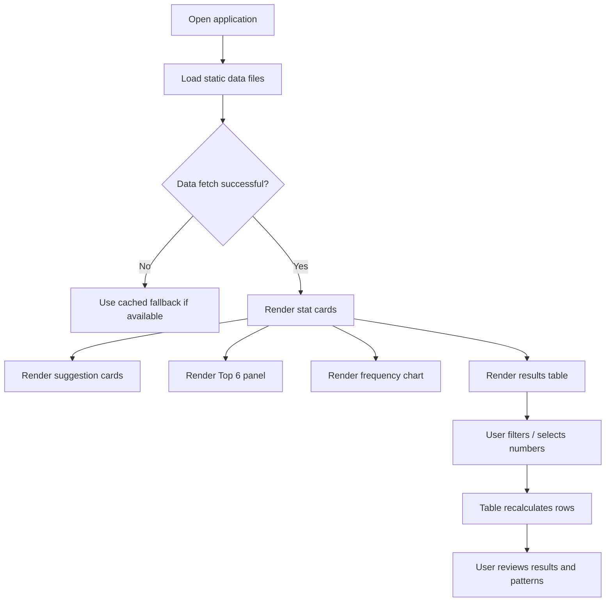
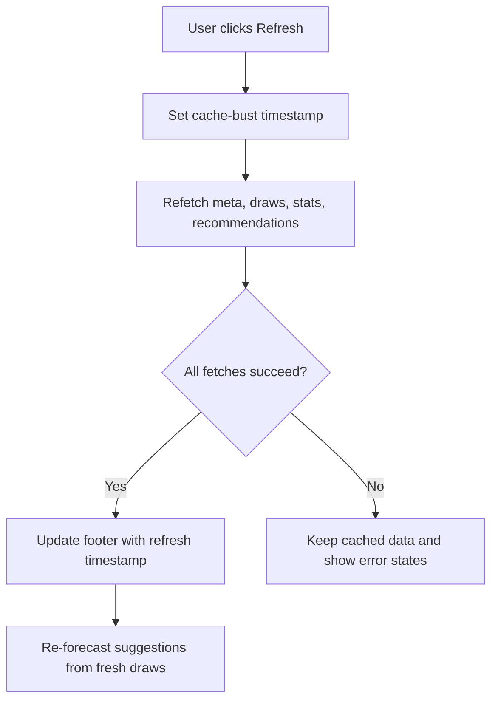
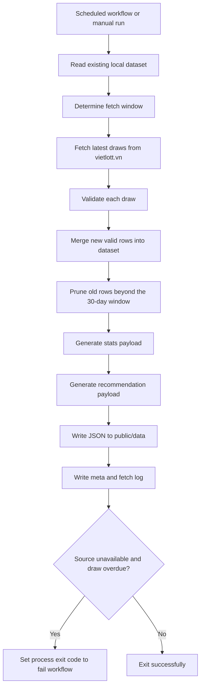

# Process Flows and User Journeys

## 1. User journey: viewing the main dashboard

### Preconditions
- App is served successfully from the static host.
- `public/data/*.json` files are available.
- Browser has network access to fetch static JSON files and any local assets.

### Flow

### Alternate flow
- If fetch fails and no cache is available, the app displays an error banner and stops rendering the main panels.

### Expected outcome
- A visitor sees overall activity, suggested numbers, frequency patterns, and recent draw history.

## 2. User journey: refresh published data

### Business rule
The refresh operation does not scrape the website directly from the browser. Instead, it fetches the static JSON files. The README explicitly states that browser-side scraping is not used because the operator site does not allow CORS and rate-limits aggressively. This is documented in [README.md](../../README.md).

## 3. System flow: data pipeline refresh

### Preconditions
- A cron or manual workflow event triggers the data pipeline.
- `pipeline/index.ts` is executed in Node.
- The source site is reachable or returns a retryable outage.

### Failure scenarios
- `SourceUnavailableError`: run status becomes partial; no prior snapshot is overwritten.
- Invalid draw records: rejected and logged but do not break the whole process.
- Unexpected detail-page failures: draw prize amounts may remain missing while the main row still loads.

## 4. User journey: number-based drill-down

### Preconditions
- A user has selected a hot number or a chart bar.

### Flow
1. User clicks a number in the Top 6 panel or frequency chart.
2. `activeNumber` state is set in [src/App.tsx](../../src/App.tsx).
3. The results table filters rows to those containing the active number or the bonus ball.
4. The active filter chip appears in the table toolbar.
5. User can clear the filter to return to the full result view.

### Expected outcome
- The table focuses on the selected number and makes it easier to correlate a number with past draws.

## 5. User journey: language switch

### Flow
1. User clicks the language switcher in the header.
2. `setLanguage` updates the i18n state and writes `app.lang` to localStorage.
3. The document language tag and title update.
4. All visible text re-renders in the selected language.

### Implementation evidence
- [src/i18n/index.ts](../../src/i18n/index.ts)
- [src/components/LanguageSwitcher.tsx](../../src/components/LanguageSwitcher.tsx)

## 6. Decision points and business outcomes

- If data is available and valid, the app shows the full dashboard.
- If source data is unavailable, it falls back to cached local data or shows an error state.
- If there are fewer than eight draws, the app displays a small-sample notice and still renders suggestions.
- If the user filters by number combination, the table changes and the focus shifts to specific patterns.

## 7. Known limitation in flows

The app does not currently include authentication, user persistence, or multistep registration. Each flow is browser-session based and does not preserve user-configured state across a new session except for the stored language preference.

---

This flow set reflects actual implemented journeys and is limited to behaviors that can be traced to the current code and static data model.
